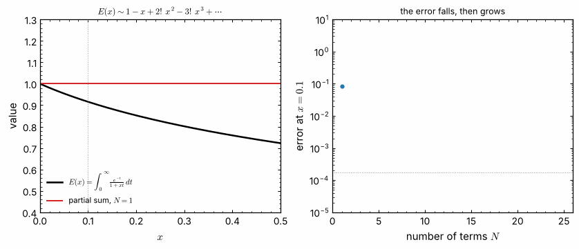
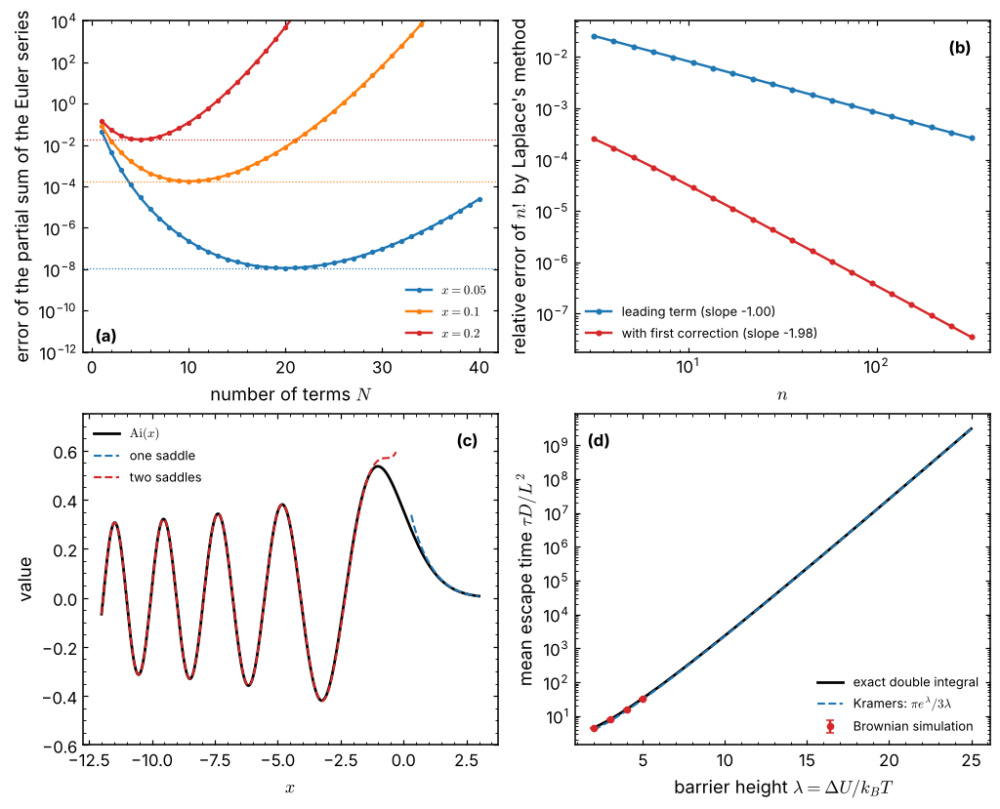
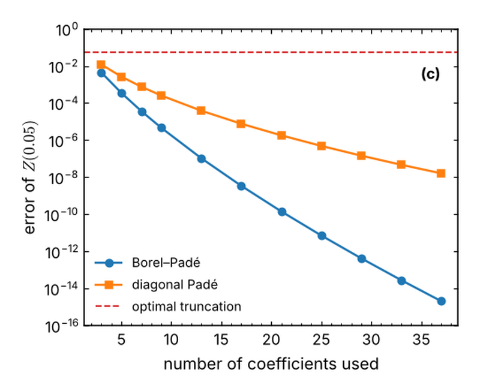
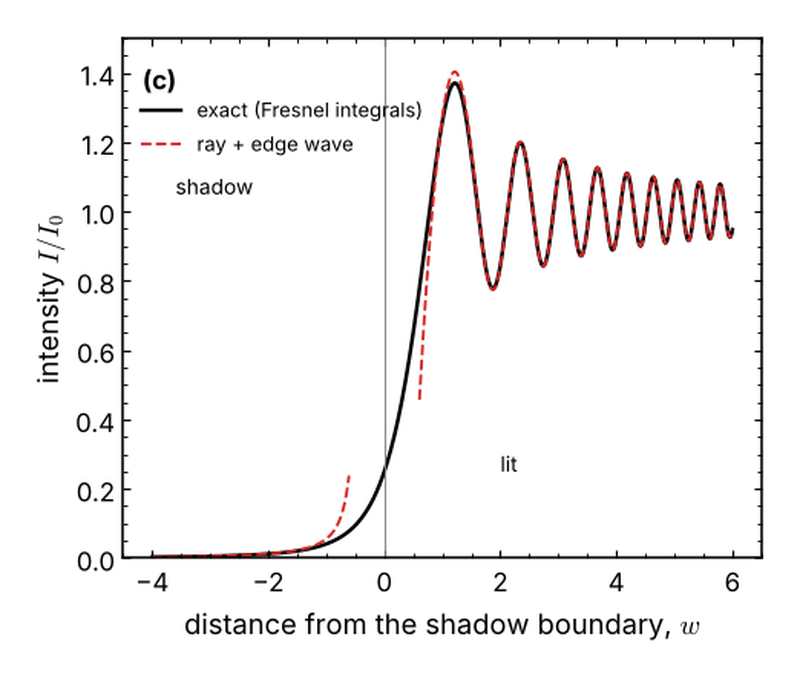
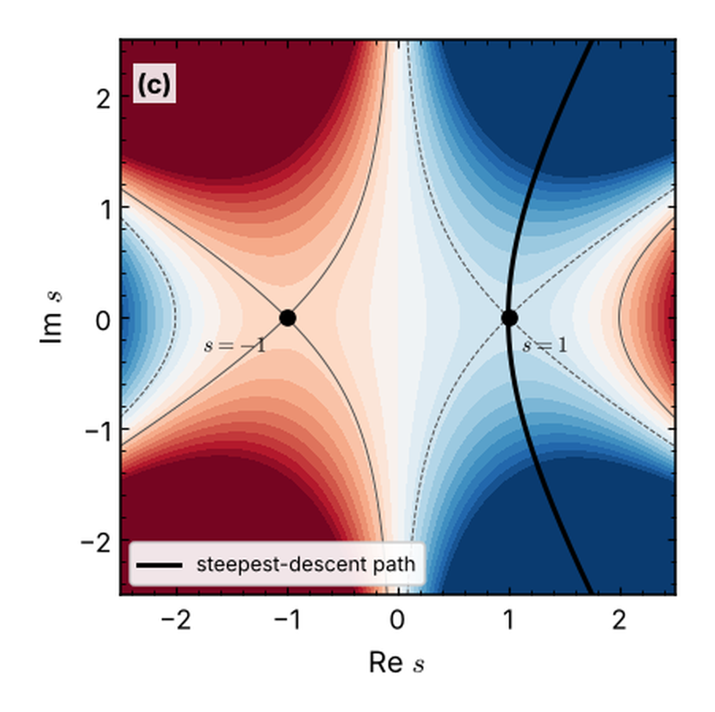
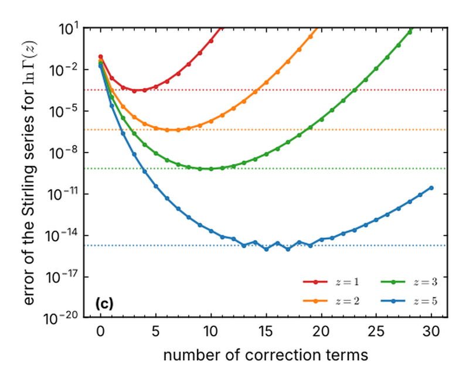
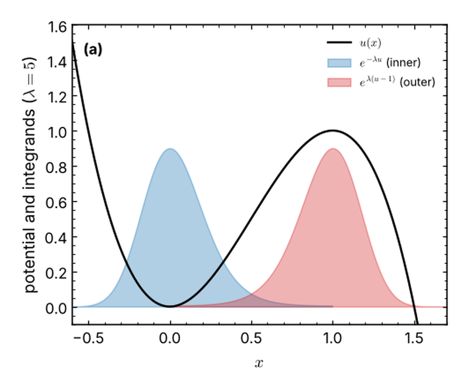
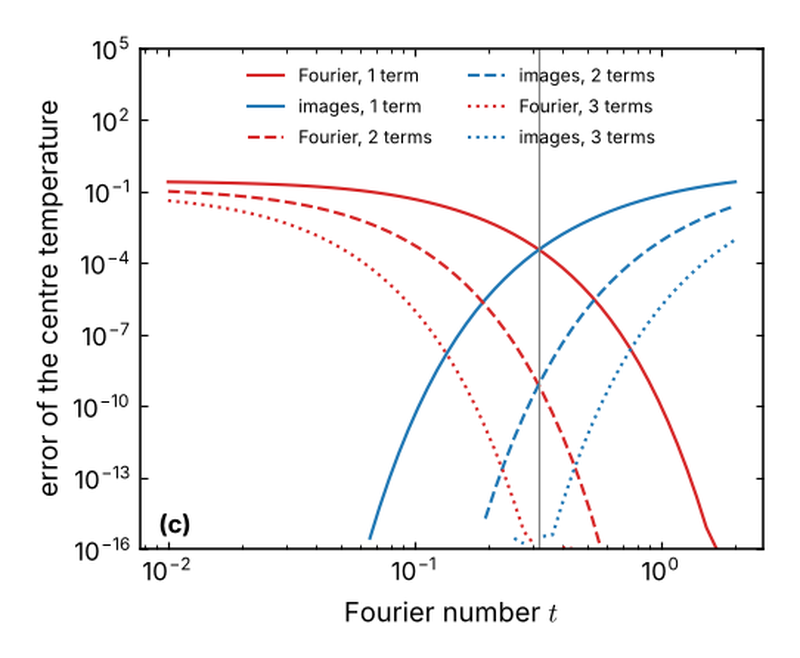

<div align="center">

# Asymptotic methods

**An open book on asymptotic expansions of integrals and sums — with every expansion checked
against high-precision numerics.**

[](https://github.com/ktwyw/math-asymptotic-methods/actions/workflows/tests.yml)
[](https://ktwyw.github.io/math-asymptotic-methods/)
[](pyproject.toml)
[](#whats-inside)
[](LICENSE)
[](DATA_LICENSE.md)



<sub>A divergent series that is still useful. The Euler series $1 - x + 2!x^2 - 3!x^3 + \cdots$ diverges for every $x > 0$, yet its partial sums approach the exact function until about $1/x$ terms, and then move away. Knowing where to stop, and how accurate the answer is there, is what this book is about. (<code>scripts/make_readme_animation.py</code>)</sub>

</div>

Most problems in physics and engineering have no closed-form solution, but many contain a parameter
that is large or small: a Reynolds number, a barrier height in units of $k_BT$, a Fourier number, the
argument of a special function. Asymptotic methods turn that parameter into approximations that are
often more accurate, and always more revealing, than a numerical solution alone. They are also easy to
get wrong: a series can diverge, an expansion can fail in part of the domain, a correction can be of the
wrong order. This repository contains **11 executed Jupyter notebooks** on expansions, integrals and sums,
including **2 worked examples** from chemical physics and heat transfer, a small tested Python module
(**`asymp`**), and a list of **[suggested references](docs/references.md)**. Differential equations (boundary layers, matching, WKB, multiple scales) are the subject of a
[companion book](#companion-books).

> **Start in 60 seconds:** open [Chapter 1](notebooks/part1_foundations/01_what_is_an_asymptotic_expansion.ipynb)
> here on GitHub (the notebooks are stored with their outputs), or go straight to
> [Chapter 10](notebooks/part3_examples/10_kramers_escape_rate.ipynb), where Kramers' escape rate is derived
> by Laplace's method and checked against a simulation.

## Why this book?

- **Every expansion is checked.** Each result is compared with the exact answer computed to high
  precision (with `mpmath` where needed), and the comparison is quantitative: the error must fall like
  the first omitted term, with the predicted slope on a log-log plot.
- **Divergence taken seriously.** Optimal truncation, its exponentially small error, and the ways to do
  better (Borel–Padé, Padé, Shanks, Richardson) are measured, not just described.
- **From mathematics to physics.** The methods are applied to escape over a barrier, heat conduction,
  diffraction, the factorial and partition functions, with dimensional numbers.
- **Two tracks.** *Core* chapters assume calculus, ordinary differential equations and a first course in
  complex variables, at the level of a senior undergraduate. *Advanced* chapters are for graduate
  students and researchers.
- **Self-contained.** Each chapter derives what it uses; books and articles for further study are listed
  at the end of each chapter and in the suggested references.
- **Readable code.** `asymp` is a few hundred lines of NumPy and mpmath, written to be read alongside the
  text.

## What the checks show

<p align="center">

</p>

Four checks, recomputed by `scripts/make_readme_figure.py`. (a) The Euler series: the error falls,
reaches a minimum near $N = 1/x$, and grows (Chapter 1). (b) Laplace's method for $n!$: the error falls
like $1/n$, and like $1/n^2$ with the first correction (Chapter 6). (c) The Airy function and its
saddle-point forms, with one saddle for $x > 0$ and two for $x < 0$ (Chapter 8). (d) Kramers' formula
against the exact mean escape time and a Brownian simulation (Chapter 10).

Measured carefully, the familiar approximations hold some surprises:

- **A divergent series beats a convergent one.** In double precision, three terms of the asymptotic series
  of erfc beat the Taylor series at $x = 5$, which never gets a correct digit
  ([Chapter 1](notebooks/part1_foundations/01_what_is_an_asymptotic_expansion.ipynb)).
- **Optimal truncation is not the end.** For the quartic integral $Z(g)$ at $g = 0.05$, the best partial
  sum is in error by 0.06; Borel–Padé summation of the same coefficients, by $2\times10^{-15}$
  ([Chapter 4](notebooks/part1_foundations/04_divergent_series_in_practice.ipynb)).
- **Kramers' formula** is 3 % low at a barrier of $10 k_BT$; its first Laplace correction brings it to
  0.4 % ([Chapter 10](notebooks/part3_examples/10_kramers_escape_rate.ipynb)).
- **The Stirling series diverges for every argument,** yet stopped at its smallest term it gives
  $\ln\Gamma(z)$ with an error of about $e^{-2\pi z}/(2\pi\sqrt z)$: $3\times10^{-4}$ at $z = 1$, and
  nine significant digits from just two correction terms at $z = 10$
  ([Chapter 9](notebooks/part2_integrals_and_sums/09_sums_euler_maclaurin_and_stirling.ipynb)).
- **The one-term rule for transient conduction** ($\mathrm{Fo} > 0.2$) costs 0.7 % at its limit and 5 %
  at $\mathrm{Fo} = 0.1$; the image series and the Fourier series converge equally fast at
  $\mathrm{Fo} = 1/\pi$ ([Chapter 11](notebooks/part3_examples/11_transient_heat_conduction.ipynb)).
- **Euler–Maclaurin** gives $\zeta(2)$ to $10^{-15}$ from nine terms of a sum that would otherwise need
  $10^{15}$ ([Chapter 9](notebooks/part2_integrals_and_sums/09_sums_euler_maclaurin_and_stirling.ipynb)).

## Installation

```bash
git clone https://github.com/ktwyw/math-asymptotic-methods.git
cd math-asymptotic-methods
pip install -e ".[notebooks]"
jupyter lab
```

Each notebook runs in under half a minute.

## Quick start

**Where to stop a divergent series** — the Euler series at $x = 0.1$:

```python
import math
import mpmath as mp
import asymp as am

x = 0.1
terms = [(-1)**n * math.factorial(n) * x**n for n in range(40)]
best = am.optimal_truncation(terms)                # stop before the smallest term
exact = float(mp.exp(1 / x) * mp.e1(1 / x) / x)   # E(x) = e^{1/x} E1(1/x) / x
print(best.n_terms, best.value)                    # 9 0.9158192  (terms 9 and 10 are equally small)
print(abs(best.value - exact), best.smallest)      # 1.9e-04, about half the first omitted term (3.6e-04)
```

**Laplace's method and its error slope** — $n! = n^{n+1}\int_0^\infty e^{n(\ln s - s)}\mathrm ds$:

```python
import numpy as np

def stirling_ratio(n, correction):
    # f(s) = ln s - s about its maximum at s = 1: f'' = -1, f''' = 2, f'''' = -6
    I = am.laplace_method(n, f0=0.0, f2=-1.0, f3=2.0, f4=-6.0, g0=1.0, correction=correction)
    return math.exp(math.log(I) + (n + 1) * math.log(n) - n - math.lgamma(n + 1))

ns = np.logspace(1, 2, 8)
for correction in (False, True):
    err = [abs(stirling_ratio(n, correction) - 1) for n in ns]
    print(am.loglog_slope(ns, err)[0])             # -1.00, then -1.97
```

## Gallery

| | |
|:-:|:-:|
| <br>Borel–Padé, diagonal Padé and optimal truncation of a divergent series ([Chapter 4](notebooks/part1_foundations/04_divergent_series_in_practice.ipynb)) | <br>Diffraction at a straight edge: geometrical ray plus edge wave ([Chapter 7](notebooks/part2_integrals_and_sums/07_stationary_phase.ipynb)) |
| <br>The steepest-descent path through the saddle of the Airy integral ([Chapter 8](notebooks/part2_integrals_and_sums/08_steepest_descent.ipynb)) | <br>The divergent Stirling series and its optimal truncation ([Chapter 9](notebooks/part2_integrals_and_sums/09_sums_euler_maclaurin_and_stirling.ipynb)) |
| <br>Escape over a barrier: the two Laplace integrals of Kramers' formula ([Chapter 10](notebooks/part3_examples/10_kramers_escape_rate.ipynb)) | <br>Heat conduction: image series against Fourier series ([Chapter 11](notebooks/part3_examples/11_transient_heat_conduction.ipynb)) |

The panels are cut from the figures stored in the notebooks by `scripts/make_readme_gallery.py`.

## What's inside

<!-- chapters:start -->

**Part I. Foundations**

| Chapter | Track | Topics |
|---|:-:|---|
| [1. What an asymptotic expansion is](notebooks/part1_foundations/01_what_is_an_asymptotic_expansion.ipynb) | core | Poincaré's definition; convergent vs asymptotic; the Euler series and optimal truncation; erfc in double precision |
| [2. Scaling: finding the small parameter](notebooks/part1_foundations/02_scaling_and_small_parameters.ipynb) | core | nondimensionalisation; a projectile; regular and singular roots; dominant balance |
| [3. Order symbols, gauge functions and uniqueness](notebooks/part1_foundations/03_order_symbols_and_gauge_functions.ipynb) | core | O, o and ~; gauge functions and uniqueness; logarithmic gauges (Lambert W); terms beyond all orders; non-uniformity |
| [4. Divergent series in practice](notebooks/part1_foundations/04_divergent_series_in_practice.ipynb) | advanced | optimal truncation and e<sup>−A/ε</sup>; Dyson's argument; Borel–Padé summation; Padé; Shanks and Richardson |

**Part II. Integrals and sums**

| Chapter | Track | Topics |
|---|:-:|---|
| [5. Integration by parts and Watson's lemma](notebooks/part2_integrals_and_sums/05_integration_by_parts_and_watsons_lemma.ipynb) | core | integration by parts (erfc, E<sub>1</sub>); Watson's lemma; fractional powers |
| [6. Laplace's method](notebooks/part2_integrals_and_sums/06_laplaces_method.ipynb) | core | Laplace's method with its first correction; Stirling's formula; I<sub>0</sub>; Beta integrals |
| [7. Stationary phase](notebooks/part2_integrals_and_sums/07_stationary_phase.ipynb) | core | stationary phase; J<sub>0</sub> and the Hankel function; endpoint contributions; diffraction at a straight edge |
| [8. Steepest descent and saddle points](notebooks/part2_integrals_and_sums/08_steepest_descent.ipynb) | advanced | steepest-descent paths; the Airy function on both sides; coalescing saddles; a Fourier transform with complex saddles |
| [9. Sums: Euler–Maclaurin and the Stirling series](notebooks/part2_integrals_and_sums/09_sums_euler_maclaurin_and_stirling.ipynb) | core | Euler–Maclaurin; harmonic numbers and ζ(2); the Stirling series and its optimal truncation; the rotational partition function |

**Part III. Worked examples**

| Chapter | Track | Topics |
|---|:-:|---|
| [10. Chemical physics: Kramers' escape rate](notebooks/part3_examples/10_kramers_escape_rate.ipynb) | core | the exact mean first-passage time; two Laplace integrals; Kramers' formula and its correction; Brownian simulation; Poisson escape |
| [11. Heat transfer: transient conduction at short and long times](notebooks/part3_examples/11_transient_heat_conduction.ipynb) | core | images vs Fourier modes; equal convergence at t = 1/π; one-term and semi-infinite approximations; beyond all orders at the centre |
<!-- chapters:end -->

**Where to start**

| If you are… | Read |
|---|---|
| a senior undergraduate meeting the subject | Chapters 1–3, 5 and 6, then Example 11 |
| a graduate student in physics or chemistry | Part I, Chapters 6, 8 and 9, then Example 10 |
| an engineer | Chapters 1–3, 6 and 9, then Example 11 |
| a researcher who wants to check an expansion | Chapters 1, 3 and 4: error slopes, gauge functions and divergent series |

## The `asymp` module

| Area | Functions |
|---|---|
| Checking orders | `relative_error`, `loglog_slope`, `local_slopes` |
| Series | `partial_sums`, `optimal_truncation`, `shanks`, `richardson`, `pade_approximant` |
| Integrals | `laplace_method` (leading term and first correction) |
| High-precision references | `mp_quad`, `mp_map`, `mp_sum` |
| Plotting | `use_style`, `panel_label` (boxed axes, inward ticks) |

## Repository layout

| Folder | Contents |
|---|---|
| [`notebooks/`](notebooks) | The 11 chapters, executed, in three folders (`part1_foundations`, `part2_integrals_and_sums`, `part3_examples`) |
| [`asymp/`](asymp) | The Python module |
| [`tests/`](tests) | 18 tests of the module against closed-form results |
| [`docs/`](docs) | [Suggested references](docs/references.md), book front page, images |
| [`scripts/`](scripts) | The scripts that make the images on this page |

To run the tests, re-execute the notebooks, or build the book as a website with
[Jupyter Book](https://jupyterbook.org) (version 2, which needs Node.js):

```bash
pip install -e ".[test]" && pytest
jupyter nbconvert --to notebook --execute --inplace notebooks/*/*.ipynb
pip install jupyter-book && jupyter-book build --html    # output in _build/html
```

The workflow `.github/workflows/book.yml` publishes the site to GitHub Pages on every push to `main`.

## Suggested references

The notebooks are self-contained. For further study:

- C. M. Bender and S. A. Orszag, *Advanced Mathematical Methods for Scientists and Engineers*
  (McGraw-Hill, 1978; Springer, 1999).
- E. J. Hinch, *Perturbation Methods* (Cambridge University Press, 1991).
- M. H. Holmes, *Introduction to Perturbation Methods*, 2nd ed. (Springer, 2013).
- N. Bleistein and R. A. Handelsman, *Asymptotic Expansions of Integrals* (1975; Dover, 1986).
- F. W. J. Olver, *Asymptotics and Special Functions* (1974; A K Peters, 1997).
- N. G. de Bruijn, *Asymptotic Methods in Analysis* (1970; Dover, 1981).

The full list, with books on the applications and the original articles, is in
**[`docs/references.md`](docs/references.md)**.

## Companion books

- **[Perturbation methods for differential equations](https://github.com/ktwyw/math-perturbation-methods)**:
  regular perturbation and its failures, boundary layers and matched asymptotic expansions, the WKB
  method, multiple scales and similarity solutions, with worked examples from fluid mechanics,
  biochemistry, quantum mechanics and mass transfer. It builds on Chapters 2 and 3 of this book and
  checks its results in the same way.
- **[Error analysis and propagation](https://github.com/ktwyw/error-analysis)**: evaluating, propagating
  and reporting uncertainty — the experimental side of the question of how accurate a number is.

## Scope and limitations

The book favours methods and checks over rigour: results are derived in the style of a physicist, and
proofs and rigorous error bounds are left to the mathematical literature. The reference values are computed, not
quoted, so each check is only as good as the numerical method behind it; the notebooks say which method
is used and at what precision. `asymp` is a teaching module; for production work the special functions
of SciPy and mpmath, and computer algebra for the expansions themselves, are the established tools.

## Roadmap

- [ ] Exponential asymptotics and the Stokes phenomenon
- [ ] Saddle-point approximations in statistics
- [ ] Checking an asymptotic result: a toolkit for expansions found in the literature
- [ ] More examples, and solutions to the exercises

Suggestions for examples from other fields are welcome as
[GitHub issues](https://github.com/ktwyw/math-asymptotic-methods/issues). See
[`CHANGELOG.md`](CHANGELOG.md) for the history.

## Author

**Yanwei Wang** [](https://orcid.org/0000-0002-8488-9833)

Department of Chemical and Materials Engineering, School of Engineering, Nazarbayev University.
This is a personal project, developed for teaching asymptotic methods to students of science and
engineering.

[GitHub](https://github.com/ktwyw) ·
[ORCID](https://orcid.org/0000-0002-8488-9833) ·
[Google Scholar](https://scholar.google.com/citations?user=PAAv_KMAAAAJ&hl=en) ·
[ResearchGate](https://www.researchgate.net/profile/Yanwei-Wang-19) ·
[LinkedIn](https://www.linkedin.com/in/yanwei-wang-1228b12/) ·
yanwei.wang@nu.edu.kz

## Citing

If you use this material in teaching or research, please cite it using the metadata in
[`CITATION.cff`](CITATION.cff) (GitHub shows a "Cite this repository" button).

## License

Code: [MIT](LICENSE). Text and figures: [CC BY 4.0](DATA_LICENSE.md).
